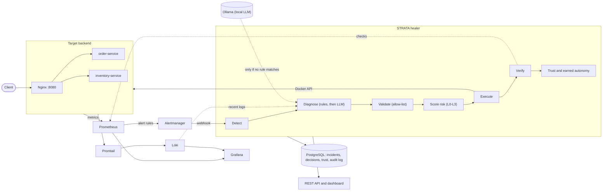
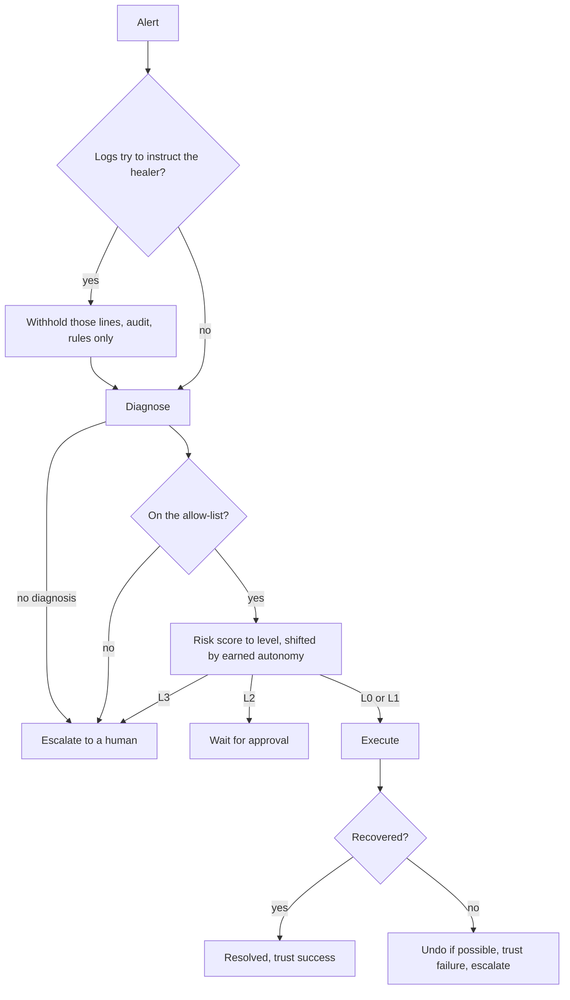

# STRATA: Self-healing with Trust and Risk-Adaptive Autonomy

When a backend service crashes, slows down or gets overloaded, an on-call engineer usually has to read the logs, find the cause and fix it by hand. That's slow, and someone has to stay awake for it. Fixing everything automatically is risky too: a wrong restart or rollback can make an outage worse, and an AI that reads logs can be tricked by text an attacker plants in them. **STRATA** is a Java self-healing backend for on-call engineers. It detects failures from observability data (Prometheus, Loki, Alertmanager), diagnoses them (rules first, a local LLM only for unknown errors), checks each proposed fix against an allow-list and scores its risk. It then runs the fix automatically, asks a human to approve it, or hands it to a human, and it raises or lowers each action's autonomy based on how well past fixes worked. Every decision goes into a tamper-evident audit log.

**Research question:** can a backend safely raise or lower its autonomy based on the measured success and risk of past actions?

**Primary use case (a service crashes):** a service instance crashes → Prometheus detects the failed health check and Alertmanager alerts STRATA → STRATA reads recent logs, matches a rule and proposes a restart → the risk score is low (one instance, easy to undo), so it restarts the service automatically → STRATA checks the metrics, confirms recovery, logs the incident and updates the restart action's success record.

**Secondary use case (a bad deployment):** a rollback scores higher risk, so the engineer must approve it on the dashboard first.

## Team

| Member | GitHub Username | Role |
|---|---|---|
| Nida Esen | [@NidaEsenn](https://github.com/NidaEsenn) | Target backend and dashboard: order and inventory services, failure switches, failure scenarios, bad-deploy and traffic-spike injection, Thymeleaf dashboard |
| Shivani Radhakrishnan | [@Shivani-Radhakrishnan](https://github.com/Shivani-Radhakrishnan) | Observability and infrastructure: Docker Compose, Prometheus, Alertmanager, Loki, Grafana, recovery verification, CI, benchmark harness |
| Madhuri Hegde | [@madhurihegde2](https://github.com/madhurihegde2) | Healer pipeline: alert webhook, detection, rule-based diagnosis, Docker actions (restart, scale out, rollback, undo), approval workflow, orchestration |
| Saahithi Mallarapu | [@saahiwrite](https://github.com/saahiwrite) | Risk, policy, trust and audit: risk scorer, YAML policy, action validator, trust and earned autonomy, LLM diagnosis, prompt-injection defense, hash-chained audit log, persistence |

## Architecture



**One incident through the healer** (`orchestration/`):



Every box writes to the hash-chained audit log. The injection screen, LLM diagnosis, earned autonomy and undo are in open PRs (see Feature Status).

## Repository Structure

The folders follow the components in our Phase 1 system design. Entries marked *(in review, #N)* are in an open pull request; *(planned, #N)* are open issues.

```
strata/
  target-services/
    order-service/        Spring Boot service that STRATA heals (metrics, JSON logs, /chaos/* failure switches)
    inventory-service/    Second Spring Boot service, behind Nginx with order-service
  strata-healer/          The STRATA healer (Spring Boot, Java 21)
    src/main/java/edu/neu/strata/healer/
      model/              Shared types between the stages: Alert, Diagnosis, ActionType, AutonomyLevel, RiskAssessment, ExecutionResult
      api/                REST endpoints: Alertmanager webhook, incidents, audit and trust; security counts (in review, #65); approvals (planned, #50)
      detection/          Turns incoming alerts into incidents (AlertParser, IncidentService)
      diagnosis/          RuleMatcher (rules.yaml) and LokiLogClient; Diagnoser chain, LlmDiagnoser and OllamaClient (in review, #58)
      validation/         ActionValidator (allow-list); LogScreen for prompt injection (in review, #65)
      policy/             PolicyLoader and RiskScorer (score 0-100 → L0-L3); AutonomyRules (in review, #69)
      execution/          DockerActionExecutor (restart), ScaleOutAction, RollbackAction (canary), CooldownGuard
      verification/       PrometheusClient and PrometheusRecoveryVerifier
      trust/              TrustService: per-action successes, failures and earned-autonomy standing
      audit/              Hash-chained audit log (HashChain, AuditLogService); InjectionReport (in review, #65)
      orchestration/      HealingOrchestrator; split into DiagnosisStage, AssessmentStage, ExecutionStage and IncidentLifecycle (in review, #67)
      persistence/        Database access: read repositories and write stores (Spring JDBC)
      dashboard/          Thymeleaf dashboard (planned, #44)
    src/main/resources/
      policy.yaml         Risk weights, level thresholds, environments, per-action risk, LLM floor, autonomy rules and the allow-list
      rules.yaml          Diagnosis rules (alert + optional log text → action and confidence)
      db/migration/       Flyway migrations: V1 schema, V2 wider outcome column, V3 earned autonomy (in review, #69)
    src/test/java/edu/neu/strata/healer/   Unit tests (JUnit 5) and integration tests (it/, Testcontainers)
  infra/
    nginx/                Load balancer config
    prometheus/           Scrape config, alert rules and promtool tests
    alertmanager/         Routes alerts to the healer's webhook
    loki/  promtail/      Log storage and log shipping
    grafana/              Data sources and the STRATA dashboard (up/down, error rate, latency, memory, logs)
  scenarios/              Catalogue of the 18 injected failures (README.md) and inject.sh
  docs/                   Phase 1 design document (phase1-design.md); benchmark results (planned, #46)
  .github/workflows/      CI: mvn verify, promtool rule tests, amtool and compose config checks
  .env.example            Example environment variables (copy to .env)
  pom.xml                 Parent pom (Spring Boot 3.3, Java 21); lists every Maven module
```

## Setup and Run

**Prerequisites:**
- Java 21
- Maven 3.9+
- Docker Desktop (or Docker Engine) with Docker Compose v2
- Git

No accounts or API keys are needed. LLM diagnosis uses a local Ollama model that runs in Docker Compose.

```bash
# Clone
git clone https://github.com/saahiwrite/strata.git
cd strata

# Configure environment (edit values as needed; never commit .env)
cp .env.example .env

# Build all modules
mvn clean package -DskipTests

# Run everything: target services, Nginx, PostgreSQL, Prometheus, Alertmanager,
# Loki, Promtail, Grafana and the STRATA healer
docker compose up --build

# With the local LLM for errors no rule matches (once #58 is merged; downloads the
# qwen2.5:0.5b model once, about 400 MB)
docker compose --profile llm up --build

# Run all tests: unit tests and the Testcontainers integration tests (Docker must be running)
mvn verify
```

**Primary use case (crash → automatic restart):**

```bash
# Crash order-service through its failure switch
./scenarios/inject.sh crash order-service

# Watch STRATA detect, restart and verify it, then check the incident and audit log
curl http://localhost:9000/api/incidents
curl http://localhost:9000/api/audit
curl http://localhost:9000/api/audit/verify
curl http://localhost:9000/api/trust
```

On a fresh clone the healer restarted order-service about 25 s after the crash, and the incident showed `RESOLVED` about 20 s after that.

**Secondary use case (bad deployment → rollback with approval):** the rollback action is merged (#66), but injecting a bad deployment (#41), approving it (#50) and the dashboard (#44) are still being built. The commands will be `./scenarios/inject.sh scenario S14`, then approving the pending rollback on `http://localhost:9000/dashboard`.

**Other places to look:** Grafana on `http://localhost:3000` (STRATA dashboard, no login needed), Prometheus on `:9090`, Alertmanager on `:9093`. `./scenarios/inject.sh list` prints every scenario.

On macOS with Colima instead of Docker Desktop, clone the repo somewhere under your home folder (Colima only shares your home folder with containers), and `mvn verify` needs `DOCKER_HOST=unix://$HOME/.colima/default/docker.sock` and `TESTCONTAINERS_DOCKER_SOCKET_OVERRIDE=/var/run/docker.sock` for the integration tests.

**Environment variables** (`.env.example`):

| Variable | Purpose |
|---|---|
| `POSTGRES_DB`, `POSTGRES_USER`, `POSTGRES_PASSWORD` | Database for incidents, decisions, trust records and the audit log |
| `HEALER_PORT` | Port of the STRATA healer (default 9000) |
| `POSTGRES_PORT`, `PROMETHEUS_PORT`, `ALERTMANAGER_PORT`, `LOKI_PORT`, `GRAFANA_PORT` | Optional host ports (5432, 9090, 9093, 3100, 3000). Change only if a port is taken |
| `GRAFANA_ADMIN_PASSWORD` | Grafana admin password (default `admin`). Dashboards can be viewed without logging in |
| `OLLAMA_PORT`, `STRATA_LLM_MODEL` | Optional, with the `llm` profile: Ollama's host port (11434) and the model (default `qwen2.5:0.5b`) (#58) |
| `DOCKER_HOST` | Only if docker-java can't find the Docker socket (some macOS/Windows setups) |

## Feature Status

**Complete / Partial / Not started** describe `main` today. Work that is finished but still in an open pull request is named in the last column, so the status moves up when it merges. Phase 3 work is tracked on the [milestone](https://github.com/saahiwrite/strata/milestone/2).

| Functional Requirement (from Phase 1) | Status | Where to Find It |
|---|---|---|
| FR1: Services expose metrics, JSON logs and failure switches (error, slow, crash, memory growth) | Complete | `target-services/*/chaos/` (`ChaosController`, `ChaosFilter`, `MemoryLeak`, `Terminator`), `logback-spring.xml`, `/actuator/prometheus`. Switches for S14-S17 (bad deploy, planted log lines) are #41 and #42 |
| FR2: Alert on defined thresholds and open an incident | Complete | `infra/prometheus/alerts.yml` (`ServiceDown`, `HighErrorRate`), `infra/alertmanager/alertmanager.yml`, `api/AlertWebhookController`, `detection/AlertParser`, `detection/IncidentService`. **In review:** `HighLatency` (p95 over 1 s) and `HighMemory` (heap over 50%) for S08-S12 (#40). Nginx down: #45 |
| FR3: Diagnose with rules first; use the LLM when no rule matches | Partial | Rules: `diagnosis/RuleMatcher`, `rules.yaml`, `diagnosis/LokiLogClient`. **In review (#58):** `Diagnoser`, `DiagnosisChain`, `LlmDiagnoser`, `OllamaClient`; Ollama in Compose |
| FR4: Treat logs as untrusted and run only allow-listed actions | Partial | `validation/ActionValidator`, `policy/AllowList`, `allowList` in `policy.yaml`. **In review:** the LLM can't choose the target and its reply is parsed strictly (#58); `validation/LogScreen`, the `INJECTION_SUSPECTED` audit entry and `GET /api/security/injections` (#65) |
| FR5: Score each action by blast radius, reversibility, environment, diagnosis confidence and past failures | Complete | `policy/RiskScorer`, `policy/PolicyLoader`, `policy.yaml` |
| FR6: Map the score to L0 auto, L1 auto with undo, L2 approval, L3 human only | Complete | `policy/RiskScorer`, `thresholds` and `minLevel` in `policy.yaml`, `model/AutonomyLevel`, `orchestration/HealingOrchestrator`. **In review:** every LLM proposal needs approval (`diagnosis.llm.minLevel`, #58) |
| FR7: Support restart, scale out and rollback | Complete | `execution/DockerActionExecutor` (restart), `execution/ScaleOutAction` (up to 3 instances), `execution/RollbackAction` (canary: one instance first, verified, then the rest), `execution/CooldownGuard`; rules `HighLatency → SCALE_OUT` and `HighErrorRate` after a deploy `→ ROLLBACK` (#66). Tested with a mocked Docker client so far |
| FR8: For L2, show a preview, wait for approval, fall back to a safe action on timeout | Partial | L2 decisions are saved as `AWAITING_APPROVAL` and audited. Approve/deny API and timeout fallback: #50 (not started); dashboard buttons: #44 (not started) |
| FR9: Verify recovery; roll back and escalate if the service did not recover | Partial | `verification/PrometheusRecoveryVerifier`, `verification/PrometheusClient`; a failed check escalates and counts as a trust failure. **In review (#68):** undo a scale out that didn't help, with an `UNDO` audit entry |
| FR10: Promote or demote each action's level from its success record | Partial | `trust/TrustService`, `trust/TrustRecord`, `GET /api/trust` (successes and failures feed the past-failures factor). **In review (#69):** `policy/AutonomyRules`, the `autonomy` section of `policy.yaml`, `AUTONOMY_CHANGE` audit entries, migration V3 |
| FR11: Write every decision to a tamper-evident audit log | Complete | `audit/HashChain`, `audit/AuditLogService`, `persistence/AuditLogRepository`, `GET /api/audit`, `GET /api/audit/verify` |
| FR12: Show incidents, approvals and action levels on a dashboard | Partial | JSON API: `api/IncidentController`, `api/AuditController`, `api/TrustController`. Thymeleaf dashboard: #44 (not started) |

**Working end to end:** the primary use case (S01, crash → automatic restart), from `docker compose up --build` and in `CrashRecoveryIT`. The secondary use case (rollback with approval) needs #41, #50 and #44; `scenarios/demo.sh` (#59) will run both.

**Benchmark (Phase 1 evaluation):** 18 scenarios in `scenarios/README.md`; S01-S12 can be injected today. The harness that runs them three ways and measures MTTR, auto-resolution rate, false-fix rate, approvals per incident and injection block rate is #46.

**Merge order for the open healer PRs:** #58 → #65 → #67 → #68 (each builds on the one before); #69 and #40 are independent.

## Scope and Design Changes Since Phase 1

| Change | Reason |
|---|---|
| Two target services (order-service, inventory-service) instead of "2 to 3" | Two services behind Nginx cover every scenario in the catalogue (single crash, both crashing, one slow while the other is healthy); a third would add build time without a new failure type |
| A shared `model/` package and the `ActionExecutor`/`RecoveryVerifier` interfaces were agreed on day 1 of Phase 2 | Four people built the stages in parallel; fixed types and interfaces let each stage be built and tested against fakes before the others existed |
| Spring JDBC (`JdbcClient`) with Flyway migrations instead of an ORM; reads (`*Repository`) and writes (`*Store`) are separate classes | The audit log must be append-only and its hash chain is computed over exact column values, so we wanted explicit SQL; separating reads from writes keeps the read-only API from being able to change anything |
| Unit tests run the real Flyway migrations on H2 in PostgreSQL mode; only the integration tests use real PostgreSQL (Testcontainers) | Keeps `mvn test` fast and Docker-free while still checking the schema; the integration tests cover PostgreSQL itself |
| Resilience4j (listed in the Phase 1 stack) is not used | Restart loops are prevented by our own `CooldownGuard` (60 s per target) and the verification timeout, which the policy and audit log need to see; a separate library added nothing for that |
| Ollama is called directly through Spring's `RestClient`, not through Spring AI or LangChain4j (#58) | It is one HTTP call with a JSON reply we parse strictly ourselves; a framework would add dependencies and hide the prompt we need to control for injection defense |
| The LLM proposes only an action and a confidence; it never chooses the target, and its confidence is capped at 0.6 (#58) | In a live test, `qwen2.5:0.5b` named the wrong container for an honest error and answered `ROLLBACK postgres` when a log line told it to. The target is always the alerting container, and the cap keeps LLM proposals scoring riskier than rules |
| Every LLM proposal needs an engineer's approval (`diagnosis.llm.minLevel: L2_APPROVAL`) (#58) | With the Phase 1 weights an LLM-proposed restart scored 16 (L0) and would have run on its own; Phase 1 expects unknown errors (S17) to wait for approval |
| Ollama runs under a Compose profile (`--profile llm`), not by default | The model is a ~400 MB download and answers in 2-8 s on a laptop CPU; without it the healer still works and escalates unknown errors to a human |
| Suspicious log lines are withheld and the LLM is skipped for that incident (#65) | Phase 1 says logs are untrusted; never showing hostile text to the model is safer than trusting the model to ignore it. Rules still run, so a crash still heals |
| Earned autonomy is bounded: at most one level of promotion and two of demotion, never below an action's `minLevel`, never out of L3 (#69) | The research question needs autonomy that moves with results, but a rollback must always need approval and an L3 action must never run automatically |
| A rollback runs on one instance first and stops if it doesn't recover; a failed rollback is escalated, not undone (#66, #68) | Phase 1's "one instance first"; going back to the broken image would not be safer than asking a human |
| `HighMemory` fires at 50% heap, not 80% (#40) | On the real stack the JVM ran out of memory at about 80% heap (the leak's 1 MiB chunks cost about 2 MiB each), so an 80% alert never fired before the crash |
| Nginx going down (S18) opens an incident but is never healed (L3, human only) | Nginx is shared by every service and is not in the allow-list, so restarting it automatically would have the largest blast radius in the system |
| The approval dashboard moved from Saahithi's Phase 3 work to Nida's | Balances the Phase 3 work across the four members; the dashboard only calls the approval API Madhuri builds |

## Design Patterns and Principles Applied

| Pattern / Principle | Where | Why |
|---|---|---|
| Layered architecture / separation of concerns | `api` → `orchestration` → stage packages (`detection`, `diagnosis`, `validation`, `policy`, `execution`, `verification`, `trust`, `audit`) → `persistence` | Controllers only parse requests and call services; each package owns one stage of the healing loop, so a change to risk scoring never touches Docker code (high cohesion, low coupling) |
| Pipeline (fixed sequence of stages) | `orchestration/HealingOrchestrator`; separate `DiagnosisStage`, `AssessmentStage`, `ExecutionStage` (in review, #67) | Every incident goes through the same ordered stages, so no path can skip validation or the audit log |
| State (explicit transition table) | `orchestration/IncidentLifecycle` (in review, #67) | One place changes an incident's status or a decision's outcome, and illegal moves (closing twice, recovering without executing) are rejected |
| Chain of Responsibility | `diagnosis/DiagnosisChain` over `RuleMatcher` and `LlmDiagnoser` (in review, #58) | "Rules first, LLM only when no rule matches" is the order of the chain; `withoutLlm()` gives the same chain minus the LLM when the logs look tampered with (#65) |
| Strategy / Dependency Inversion | `execution/ActionExecutor`, `verification/RecoveryVerifier`, `diagnosis/Diagnoser`, `diagnosis/LlmClient` | The orchestrator depends on interfaces, not on Docker, Prometheus or Ollama; tests swap in fakes, and another model server would be one new class |
| Delegation per action | `DockerActionExecutor` hands `SCALE_OUT` to `ScaleOutAction` and `ROLLBACK` to `RollbackAction` | Each action's Docker steps (and its undo, #68) live in one small class |
| Dependency Injection (constructor injection) | All services; `@Configuration` classes `PolicyConfig`, `AuditConfig`, `DockerConfig`, `VerificationConfig`, `TrustConfig`, and `DiagnosisConfig` (#58) | Every dependency is explicit and replaceable; `HealingOrchestratorTest` builds the orchestrator with mocks and a same-thread executor |
| Repository pattern with read/write separation | `persistence/IncidentRepository`, `AuditLogRepository`, `TrustRepository` (read) and `IncidentStore`, `DecisionStore` (write) | SQL stays in one package; the read-only API can't write |
| Configuration over code (Open/Closed) | `policy.yaml` (weights, thresholds, allow-list, LLM floor, autonomy rules), `rules.yaml` | New rules, weights, thresholds and allowed targets need no code change (Phase 1: "policy changes need only a YAML edit") |
| Pure rules separated from I/O | `policy/RiskScorer`, `policy/AutonomyRules` (in review, #69) | Scoring and promotion/demotion are plain functions of their inputs, so they are tested exhaustively without a database |
| Fail fast | `policy/PolicyLoader`, `PolicyConfig` | A policy whose weights don't add up to 100, or that has unknown keys, actions or levels, stops the healer at startup instead of scoring wrongly |
| Immutable value objects (Java records) | `model/*`, `Rule`, `Policy`, `AuditEntry`, `TrustRecord`, `ValidationResult` | Data passed between stages can't be changed by a later stage; records validate their fields in their constructors |
| Hash chain (tamper evidence) | `audit/HashChain`, `audit/AuditLogService` | Each audit entry stores the SHA-256 of the previous one, so a changed, deleted or reordered entry breaks `GET /api/audit/verify` |
| Allow-list (default deny) and defense in depth | `validation/ActionValidator`, `policy/AllowList`; `LogScreen` (#65); target lock and strict parsing in `LlmDiagnoser` (#58) | Logs are untrusted input. Several independent checks each stop an injected action on their own: the screen, the target lock, strict JSON, the allow-list, and the LLM approval floor |

## Testing

- **Unit tests (JUnit 5, Mockito, MockMvc), on `main`:** 179 in `strata-healer`, covering:
  - shared types, policy loader, risk scorer, allow-list and action validator
  - hash chain, and the audit log service including tampering and 40 concurrent appends
  - schema migrations, trust, API, webhook, alert parser, incidents
  - rule matcher, cooldown, Docker executor, scale out, rollback with canary, execution wiring
  - Loki client, orchestrator, Prometheus client and recovery verifier

  The target services have 23 each in `order-service` and `inventory-service` (API, metrics, JSON logging, every chaos switch). The persistence tests run the real Flyway migrations on H2 in PostgreSQL mode.
- **Integration tests (Testcontainers):** `CrashRecoveryIT` kills a real container, posts a `ServiceDown` alert and checks that the healer restarts it, resolves the incident and keeps the audit chain valid, on real PostgreSQL. **In review:** `PromptInjectionIT` (#65) runs S15 and S16 through the whole healer with the LLM switched on. It also covers a line the screen misses and a malformed model reply, and checks that nothing ever runs.
- **In open PRs:** `LlmDiagnoserTest`, `OllamaClientTest` and `DiagnosisChainTest` (#58); `LogScreenTest` with 16 malicious and 13 ordinary lines, and `InjectionReportTest` (#65); `IncidentLifecycleTest`, the stage tests and `OrchestrationDesignTest` (#67); undo tests (#68); `AutonomyRulesTest` and earned-autonomy cases in the trust, scorer and orchestrator tests (#69). #68 reports 293 healer unit tests with #58, #65 and #67 included.
- **Monitoring config:** promtool unit tests for the alert rules (`infra/prometheus/tests/alerts-test.yml`), including cases that must stay quiet (a service still starting, errors below the threshold); CI also checks the Prometheus and Alertmanager configs and `docker-compose.yml`. #40 adds tests for `HighLatency` and `HighMemory`.
- **Live check of the LLM:** the prompt was run against `qwen2.5:0.5b` in Ollama for S17 (unknown error → `RESTART`, which waits for approval), an `OutOfMemoryError` (→ `RESTART`) and S15 (→ a malformed reply, which is refused). The real replies are kept as test cases.
- **Coverage:** a JaCoCo report in CI is being added (#47).

All tests pass on `main`, locally and in GitHub Actions (`.github/workflows/ci.yml`), which runs on every push and pull request.

```bash
mvn test                                   # unit tests, all modules (no Docker needed)
mvn verify                                 # unit + integration tests (Docker must be running)
mvn -pl strata-healer test                 # healer unit tests only
mvn -pl strata-healer verify -Dit.test=CrashRecoveryIT   # one integration test
docker run --rm -v "$PWD/infra/prometheus:/p" -w /p/tests --entrypoint promtool prom/prometheus:v3.5.0 test rules alerts-test.yml
```

## Known Issues

- An L2 decision stops at `AWAITING_APPROVAL` with no way to approve or deny it yet (approval API #50, dashboard #44), so the secondary use case doesn't run end to end yet.
- Scale out and rollback have only been tested with a mocked Docker client, not on the running Compose stack; the bad-deploy image they roll back from is #41.
- On `main`, an error no rule matches is escalated to a human, because LLM diagnosis is still in review (#58).
- The small local model is overconfident (it answered 0.9-1.0 for guesses) and can be steered by log text. The cap, the target lock, the approval floor and the injection screen are there because of this; a larger model is a configuration change (`STRATA_LLM_MODEL`).
- The injection screen is pattern based, so a reworded instruction can get past it. The later checks still block it (tested in `PromptInjectionIT`), but the screen alone isn't enough.
- The healer mounts the Docker socket, which gives it full control of every container; a socket proxy that allows only the calls it needs is #63.
- `order-service` and `inventory-service` each have an identical copy of the chaos package (#60).
- Failure switches live in memory, so a restart resets them. This is intended (it's what lets a restart fix S05-S12), but a switch can't survive a restart for testing.
- The integration tests need Docker; on Colima they need the two extra environment variables above.

## Team Contributions (Phase 3)

> Each member checks their own row before submission and adds anything missing (features, classes, files, tests and reviews). Phase 3 issues are on the [milestone](https://github.com/saahiwrite/strata/milestone/2).

| Member | Contributions This Phase |
|---|---|
| Nida Esen | _To be filled in._ Assigned: #41 bad-deploy image, #42 chaos log switch, #43 traffic spike, #44 dashboard, #59 demo script, #60 shared chaos module |
| Shivani Radhakrishnan | **Healer in Compose and CI (#38):** added the services, Nginx and the healer to Compose, `CrashRecoveryIT` and the GitHub Actions CI; followed the README from a fresh clone and fixed two bugs it found (`ServiceDown` firing while services were still starting, and a 30 s recovery timeout that marked good restarts as failures). **In review (#40):** `HighLatency` and `HighMemory` alert rules with promtool tests, and why 50% heap rather than 80%. Assigned: #45, #46, #47, #48, #63 |
| Madhuri Hegde | **Scale out and rollback (#66):** `ScaleOutAction`, `RollbackAction` with a canary, `ComposeServices`, `ContainerCloner`, the new rules in `rules.yaml` and the allow-list; `ScaleOutActionTest`, `RollbackActionTest`, `ExecutionWiringTest`. **In review:** the orchestrator split into stages with `IncidentLifecycle` and `DecisionOutcome` (#67); undo of a failed scale out with `UNDO` audit entries (#68). Assigned: #50 |
| Saahithi Mallarapu | Planned Phase 3 (milestone and issues #41-#64) and wrote this README (feature status, scope changes, design patterns, diagrams, testing, known issues). **In review:** LLM diagnosis with Ollama (`Diagnoser`, `DiagnosisChain`, `LlmDiagnoser`, `OllamaClient`, the LLM approval floor in the policy, Ollama in Compose, and a live check against the real model) (#58); prompt-injection defense (`LogScreen`, `INJECTION_SUSPECTED`, `InjectionReport`, `GET /api/security/injections`, `PromptInjectionIT`) (#65); earned autonomy (`AutonomyRules`, the `autonomy` policy section, migration V3, `AUTONOMY_CHANGE` audit entries) (#69). Assigned: #62, #64, and the submission (#55) |

<details>
<summary>Phase 2 contributions</summary>

| Member | Contributions in Phase 2 |
|---|---|
| Nida Esen | Built `order-service` and `inventory-service` (Spring Boot 3, Actuator, Prometheus metrics, JSON logs via Logback); the failure switches (crash, error rate, slow responses, memory growth, reset) with their metrics; the Nginx entry point on :8080; the 18-scenario failure catalogue and `scenarios/inject.sh`; `ChaosControllerTest`, `ChaosStateTest`, `MemoryLeakTest`, `OrderControllerTest`, `InventoryControllerTest`, `JsonLoggingTest` |
| Shivani Radhakrishnan | Docker Compose file with PostgreSQL, Prometheus, Alertmanager, Loki, Promtail and Grafana; Prometheus scrape config; `ServiceDown` and `HighErrorRate` alert rules with promtool tests; Alertmanager webhook to the healer; Grafana dashboard (up/down, error rate, latency, memory, logs); `PrometheusClient` and `PrometheusRecoveryVerifier` with unit tests (#23-#26); added the services, Nginx and the healer to Compose, `CrashRecoveryIT` and the GitHub Actions CI (#15) |
| Madhuri Hegde | Built the healer pipeline in `strata-healer`.<br>**Skeleton and webhook (#19):** the Spring Boot application, its package layout and `POST /api/alerts`, which accepts Alertmanager JSON and returns 202.<br>**Detection (#28):** `AlertParser`, which turns the webhook payload into alerts and skips resolved or incomplete ones, and `IncidentService`, which opens, resolves and escalates incidents and reuses the open incident when Alertmanager repeats an alert.<br>**Diagnosis and execution (#29):** `RuleMatcher` with `rules.yaml` (a crash maps to a restart, with a more specific rule when the logs show `OutOfMemoryError`); `LokiLogClient`; `DockerActionExecutor`, which restarts a named container through docker-java; and `CooldownGuard`.<br>**Orchestration (#33):** `HealingOrchestrator`, which runs an alert through diagnosis, validation, risk scoring, execution, recovery verification, the audit log and the trust record, and handles L2 (waits for approval), L3 (hands to a human) and failures (escalates). It saves incidents and decisions to the database (`IncidentStore`, `DecisionStore`), and the `V2` migration fixes the `decisions.outcome` column, which was too short for `AWAITING_APPROVAL`.<br>**Tests:** `AlertWebhookControllerTest`, `AlertParserTest`, `IncidentServiceTest`, `RuleMatcherTest`, `CooldownGuardTest`, `DockerActionExecutorTest`, `LokiLogClientTest` and `HealingOrchestratorTest` (10 cases). |
| Saahithi Mallarapu | Set up the repository (folder scaffold, `.env.example`, `.gitignore`, labels, the Phase 2 milestone and issues), and wrote this README and the Phase 1 design doc (`docs/phase1-design.md`).<br>**Shared foundation (#20):** the parent `pom.xml`, and the types every healing stage uses: `Alert`, `Diagnosis`, `ActionType`, `AutonomyLevel`, `RiskAssessment`, `ExecutionResult`, `ActionExecutor` and `RecoveryVerifier`.<br>**Risk policy (#21):** `policy.yaml` (factor weights, level thresholds, environments, per-action risk); `PolicyLoader`, which reads it safely and stops startup on a bad policy; and `RiskScorer`, which turns blast radius, reversibility, environment, diagnosis confidence and past failures into a score of 0-100 and a level from L0 to L3.<br>**Validation and audit (#22):** the action allow-list and `ActionValidator`, which rejects unlisted actions and target names injected through logs; the Flyway schema (`incidents`, `decisions`, `action_trust`, `audit_log`); and the SHA-256 hash-chained audit log (`HashChain`, `AuditLogService`), which detects changed, deleted, reordered or forged entries.<br>**Trust and API (#30):** `TrustService`, which keeps each action's successes and failures and feeds them into the risk score; and the read-only endpoints `GET /api/incidents`, `/api/incidents/{id}`, `/api/audit`, `/api/audit/verify` and `/api/trust`.<br>**Tests:** 105 JUnit 5 tests in the healer, run by `mvn verify`, including `PolicyLoaderTest`, `RiskScorerTest`, `ActionValidatorTest`, `HashChainTest`, `AuditLogServiceTest` (tampering and 40 concurrent appends), `SchemaMigrationTest`, `TrustServiceTest` and `ApiTest`.<br>**End of Phase 2 (#31):** brought the README's progress, testing and structure sections up to date. |

</details>
